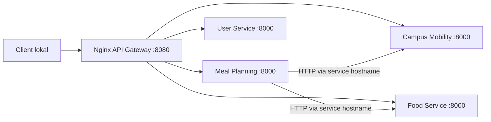

# Dine-N-Dash

Dine-N-Dash membantu mahasiswa memilih tempat makan yang sesuai dengan waktu
jeda antarkelas dan perkiraan perjalanan kaki di kampus. Implementasi ini
menyediakan empat microservice FastAPI terpisah dan Nginx API Gateway untuk
pengembangan lokal.

## Status proyek

Tahap 1–8 selesai dan diuji di lingkungan lokal. Mobility, Food, dan data
perjalanan/waktu tunggunya masih sample/mock, bukan data operasional
terverifikasi. User Service hanya memvalidasi format request; penyimpanan akun,
registrasi aktif, dan autentikasi belum tersedia. Docker Compose dan gateway
berfungsi secara lokal. Deployment STB, Cloudflare Tunnel, dan URL publik
belum dilakukan.

## Arsitektur



Gateway adalah satu-satunya container yang mempublikasikan port ke host.
Komunikasi antarkontainer memakai nama service di jaringan Docker. Di luar
Docker, service dapat dijalankan pada port lokal 8001–8004.

## Struktur

```text
campus-mobility-service/
  app/                 # main.py, data.py, schemas.py
  tests/               # health dan Mobility API
  requirements.txt
  pytest.ini
  Dockerfile
food-service/
  app/                 # main.py, data.py, schemas.py, services.py
  tests/               # health dan Food API
  requirements.txt
  Dockerfile
meal-planning-service/
  app/
    clients/           # HTTP clients untuk Food dan Mobility
    services/          # kalkulasi rekomendasi
    schemas.py
    main.py
  tests/               # aturan bisnis, HTTP clients, dan API
  requirements.txt
  Dockerfile
user-service/
  app/                 # main.py dan schema request auth
  tests/               # health, validasi, dan batasan auth
  requirements.txt
  Dockerfile
nginx/
  nginx.conf
docs/
  api-contract.md
docker-compose.yml
.env.example
.gitignore
```

## API

Semua service menyediakan `GET /health`. Endpoint utama:

| Service | Method dan path | Fungsi |
|---|---|---|
| Mobility | `GET /locations` | Daftar lokasi kampus sample |
| Mobility | `GET /routes/estimate?origin=Labtek%20V&destination=Warung%20A` | Estimasi jalan kaki dalam menit |
| Food | `GET /restaurants` | Daftar restoran sample |
| Food | `GET /restaurants/{restaurant_id}` | Detail restoran |
| Food | `GET /restaurants/{restaurant_id}/availability?arrival_time=11:40&meal_mode=dine_in` | Status buka, mode layanan, waktu tunggu |
| Meal Planning | `POST /recommendations` | Rekomendasi berdasarkan jadwal dan rute |
| User | `POST /auth/register` | Validasi request; saat ini HTTP 501 |
| User | `POST /auth/login` | Validasi request; saat ini HTTP 501 |

Respons dan aturan API lengkap dijelaskan di [docs/api-contract.md](docs/api-contract.md).
Dokumentasi interaktif FastAPI tersedia di `/docs` pada setiap service.

Contoh request Meal Planning:

```json
{
  "origin": "Labtek V",
  "destination": "Labtek VIII",
  "ready_time": "11:40",
  "class_start": "12:30",
  "buffer_minutes": 5,
  "meal_mode": "dine_in",
  "meal_duration_minutes": 18
}
```

Dengan data mock saat ini, Warung A menghasilkan `remaining_minutes: 4` dan
`departure_deadline: "12:17"`. Hasil tersebut hanya memverifikasi kalkulasi
terhadap data contoh, bukan kondisi kampus nyata.

## Menjalankan lokal tanpa Docker

Gunakan Python dan PowerShell. Dari root workspace, buat satu virtual
environment bersama, pasang dependency tiap service ke environment tersebut:

```powershell
python -m venv .venv
.\.venv\Scripts\Activate.ps1
pip install -r campus-mobility-service\requirements.txt
pip install -r food-service\requirements.txt
pip install -r meal-planning-service\requirements.txt
pip install -r user-service\requirements.txt
```

Buka empat terminal PowerShell pada root workspace dan jalankan satu service
per terminal:

```powershell
Set-Location campus-mobility-service
uvicorn app.main:app --reload --port 8001
```

```powershell
Set-Location food-service
uvicorn app.main:app --reload --port 8002
```

```powershell
Set-Location meal-planning-service
$env:MOBILITY_SERVICE_URL = "http://127.0.0.1:8001"
$env:FOOD_SERVICE_URL = "http://127.0.0.1:8002"
$env:SERVICE_TIMEOUT_SECONDS = "3"
uvicorn app.main:app --reload --port 8003
```

```powershell
Set-Location user-service
uvicorn app.main:app --reload --port 8004
```

Periksa `/health` pada port 8001–8004. `POST /recommendations` memerlukan
Mobility dan Food aktif. `.env.example` tidak dimuat otomatis oleh aplikasi
lokal; set environment variable seperti contoh di atas.

## Pengujian

Dengan environment aktif, jalankan tes dari root workspace:

```powershell
Push-Location campus-mobility-service
pytest -q
if ($LASTEXITCODE -ne 0) { throw "Campus Mobility tests failed" }
Pop-Location

Push-Location food-service
pytest -q
if ($LASTEXITCODE -ne 0) { throw "Food Service tests failed" }
Pop-Location

Push-Location meal-planning-service
pytest -q
if ($LASTEXITCODE -ne 0) { throw "Meal Planning tests failed" }
Pop-Location

Push-Location user-service
pytest -q
if ($LASTEXITCODE -ne 0) { throw "User Service tests failed" }
Pop-Location
```

Tes mencakup validasi/error API, kalkulasi rekomendasi, request dependency
HTTP, keamanan kerangka autentikasi, dan health check.

## Docker Compose dan Nginx

Prasyarat: Docker Desktop berjalan. Compose membangun empat FastAPI service dan
menjalankan Nginx API Gateway pada port host 8080 secara default.

```powershell
docker compose build
docker compose up -d
docker compose ps
docker compose logs
```

Endpoint melalui gateway:

- `http://127.0.0.1:8080/api/mobility/health`
- `http://127.0.0.1:8080/api/food/restaurants`
- `http://127.0.0.1:8080/api/meal-planning/health`
- `http://127.0.0.1:8080/api/users/health`

Untuk rekomendasi, kirim request contoh di atas ke
`http://127.0.0.1:8080/api/meal-planning/recommendations`. Nginx menghapus
prefix gateway sebelum meneruskan path. Port internal service tidak
dipublikasikan. Setiap container memiliki health check, restart policy, dan
batas awal CPU/memori yang dapat disesuaikan di [docker-compose.yml](docker-compose.yml).
Gunakan `docker compose down` untuk menghentikan stack lokal.

## Environment dan keamanan

| Variable | Penggunaan | Default/contoh |
|---|---|---|
| `GATEWAY_PORT` | Port host Nginx di Docker Compose | `8080` |
| `MOBILITY_SERVICE_URL` | URL Mobility untuk Meal Planning lokal | `http://127.0.0.1:8001` |
| `FOOD_SERVICE_URL` | URL Food untuk Meal Planning lokal | `http://127.0.0.1:8002` |
| `SERVICE_TIMEOUT_SECONDS` | Timeout request dependency Meal Planning | `3` |

`MOBILITY_PORT`, `FOOD_PORT`, `MEAL_PLANNING_PORT`, dan `USER_PORT` di
`.env.example` adalah referensi port untuk perintah Uvicorn lokal; saat ini
port lokal diberikan secara eksplisit pada perintah Uvicorn dan Compose tidak
membaca variabel tersebut.

`.env.example` hanya berisi nilai lokal non-secret. Salin ke `.env` bila perlu
mengatur Compose; `.env` diabaikan Git. Container Compose menetapkan URL
dependency memakai hostname `campus-mobility-service` dan `food-service`.
Jangan menyimpan password, token, API key, atau credential di source code/Git.
Brief AI `Dine_N_Dash_Copilot_Project_Brief.md` juga dikecualikan Git sesuai
permintaan.

## Data mock dan asumsi

- Mobility mencakup Labtek V, Labtek VIII, serta Warung A–E; waktu rute
  sample bersifat dua arah dengan durasi sama.
- Food menyediakan lima restoran sample dengan jam, mode layanan, dan waktu
  tunggu berbasis rentang jam.
- Jam operasional mock dianggap sama setiap hari. Jam buka inklusif, jam
  tutup eksklusif.
- Waktu meal planning adalah waktu lokal tanpa zona waktu, dalam satu hari.
  Jadwal lintas tengah malam tidak didukung dan kandidat semacam itu tidak
  direkomendasikan.
- Untuk `takeaway`, durasi makan di lokasi adalah nol. `dine_in` memerlukan
  `meal_duration_minutes`.
- User Service tidak menyimpan atau memverifikasi kredensial. Input valid pada
  register/login menghasilkan HTTP 501; input invalid menghasilkan HTTP 422.

## TODO setelah STB tersedia

- Menyiapkan akses/jaringan STB dan environment variable di perangkat.
- Menjalankan serta memverifikasi Docker Compose pada STB.
- Mengonfigurasi Nginx dan Cloudflare Tunnel dengan credential yang dikelola
  di luar source code.
- Menguji deployment dari jaringan luar dan mencatat URL publik yang benar-benar
  terverifikasi.
- Mengintegrasikan aplikasi React Native dan API kelompok lain.

Tidak ada deployment STB, konfigurasi Cloudflare Tunnel, atau URL publik pada
tahap lokal ini.
